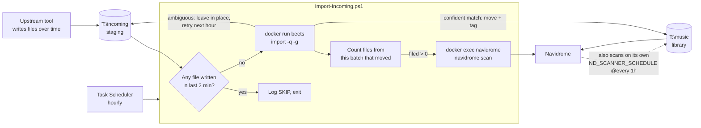

# navidrome-media-pipeline

Scripts and config from a self-hosted [Navidrome](https://www.navidrome.org/) music server on
Windows with Docker: an hourly unattended ingest that tags and files new music with
[beets](https://beets.io/), the Navidrome compose file, and a read-only podcast corruption check.

The notes below on silent failures and their fixes are as much the point as the scripts.

## Contents

| Path | What it is |
| --- | --- |
| [`scripts/Import-Incoming.ps1`](scripts/Import-Incoming.ps1) | Hourly scheduled task. Waits for the staging folder to go quiet, runs beets in a throwaway container to tag and move confident matches into the library, then triggers a Navidrome rescan. |
| [`navidrome/docker-compose.yml`](navidrome/docker-compose.yml) | Navidrome with an hourly scanner schedule and full purge of missing files. |
| [`scripts/Check-PodcastAudio.ps1`](scripts/Check-PodcastAudio.ps1) | Read-only ffprobe/ffmpeg pass over a podcast folder that flags unreadable, zero-length, short, truncated, or undecodable files. |
| [`beets/config.yaml`](beets/config.yaml) | beets config the ingest mounts as `/config`: path format matching the existing library, explicit `musicbrainz` plugin, widened MusicBrainz search, and `lastgenre` settings. |
| [`beets/beetsplug_local/lastfmkey.py`](beets/beetsplug_local/lastfmkey.py) | Local beets plugin. See [The lastfmkey plugin](#the-lastfmkey-plugin). |

## The lastfmkey plugin

beets' `lastgenre` plugin uses a shared Last.fm API key hard-coded in beets. `lastfmkey.py` does
three things:

- **Uses your own Last.fm key** from `/config/lastfm-key.txt` (path configurable with
  `lastfmkey: {keyfile: ...}`). It sets the key at import time, because `lastgenre` builds its
  Last.fm client when its module is imported, and patches an existing client if `lastgenre` loaded
  first. With no key file it logs a warning and keeps the shared key.
- **Skips flagged albums.** Albums or tracks with the flexible attribute `lastgenre_skip` set are
  left alone by `lastgenre`, which would otherwise write tags from blank database values.
- **Blocks file writes for flagged items.** A `write` event listener raises `WriteError` before the
  file is opened, so `write`, `modify`, `import`, and `lastgenre` can update the database but not
  the file.

It patches beets internals (`plugins.LASTFM_KEY` and `LastGenrePlugin._process`), so it's tied to
the beets version it was tested on: **beets 2.14.0** (`linuxserver/beets` image, Python 3.12).
Check it after upgrading beets.

Setup: copy `beets/lastfm-key.txt.example` to `beets/lastfm-key.txt` and put your key in it. The
real file is in `.gitignore`.

## Ingest flow

Safety properties:

- **Never touches a file mid-write.** If anything in staging changed in the last 2 minutes, the run
  skips and tries again next hour.
- **Never deletes.** beets quiet mode moves confident matches only. Anything ambiguous stays in
  staging for the next run. Partial albums score too low to match, so they wait until complete.
- **Counts what this batch actually filed**, by checking which of the files it started with are
  gone, rather than subtracting totals. New arrivals during a run once made the count negative
  ("filed -1"), which skipped the rescan after a run that really had filed tracks.

## Silent failures worth knowing about

Each of these produced no error. The pipeline looked healthy while doing nothing.

- **`ND_SCANSCHEDULE` is silently ignored.** In Navidrome v0.63 the variable is
  `ND_SCANNER_SCHEDULE`, and the scheduled scan is off by default. With the old name the scanner
  never ran on a schedule: the disk had 544 tracks and the database 389.
- **Listing one beets plugin removed the default one.** In beets 2.x, setting
  `plugins: lastgenre` replaced the implicit `musicbrainz` plugin. The hourly import then found zero
  candidates and finished in 5 seconds instead of about 8 minutes. The fix is to list
  `musicbrainz` explicitly.
- **beets quiet mode can't file a partial album, whatever the threshold.** Quiet mode only applies
  a "strong" recommendation, and a missing track caps the match at "medium" regardless of
  distance, so raising `strong_rec_thresh` doesn't help. Found by reading beets'
  `_summary_judgment` rather than the docs.
- **`mp3gain /p` hid 1,147 of 1,148 tag changes from Navidrome.** `/p` preserves file timestamps,
  and Navidrome's scanner decides what changed by mtime.
- **Windows PowerShell 5.1 turned a successful rescan into a failure.** Navidrome writes its
  startup banner to stderr. Under `$ErrorActionPreference = 'Stop'`, 5.1 converts native stderr
  into terminating ErrorRecords before `2>$null` applies, so every successful run logged an error
  and exited 1. The script relaxes the preference for that one call and judges the scan by its
  exit code.
- **beets read one flat staging folder as one album.** Staging holds tracks from many albums, so
  the import needs `-g` / `--group-albums`.

## Requirements

- Windows with PowerShell 5.1 or 7, and Docker Desktop.
- The `linuxserver/beets` and `deluan/navidrome` images.
- ffmpeg and ffprobe on `PATH` for `Check-PodcastAudio.ps1`.

Paths (`T:\incoming`, `T:\music`, `D:\Projects\beets\config`) are set at the top of
`Import-Incoming.ps1`. Change them for your machine; point `$ConfigDir` at this repo's `beets`
folder.

## License

MIT. See [LICENSE](LICENSE).
